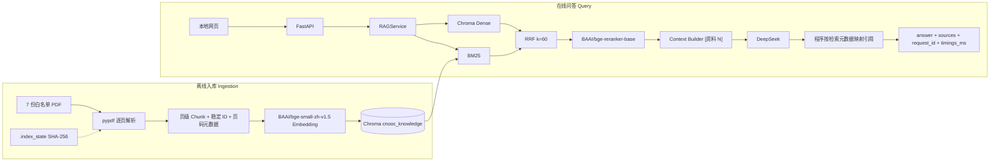

# enterprise-knowledge-agent

基于 CNOOC 官方资料的企业知识库 RAG 本地原型。当前实现 7 份白名单 PDF 的离线入库、Chroma 向量检索、BM25、RRF、Cross-Encoder Reranker、DeepSeek 生成，并提供共享服务层的 CLI、FastAPI 与同源本地问答页面。

> 当前是本地单用户原型，不是生产系统。没有身份认证、ACL、上传、Docker、GraphRAG、Agent 或企业部署能力；不要把它描述为“生产级”或“已高并发验证”。

## P0 交付与验证状态（2026-11-09）

本项目按《企业级 RAG 项目架构与开发指导》的 P0 范围完成了本地可运行、可演示、结果可复核的交付：

- 真实 DeepSeek 问答：完成 4 次有限调用（2 个有答案问题、1 个无答案问题、1 次修复后复测）；引用文件/页码/Chunk ID 已核对，原页短证据支持答案结论。详见 [`reports/p0_real_qa_verification.md`](reports/p0_real_qa_verification.md)。
- 检索评测：`eval/cnooc_eval_v1.json` 共 31 题（26 道有答案、5 道无答案），在同一索引快照上对比 Dense-only、BM25-only、Hybrid/RRF、Hybrid/RRF+Reranker。详见 [`reports/eval/cnooc_retrieval_eval_v1.md`](reports/eval/cnooc_retrieval_eval_v1.md)。
- 干净环境复现：全新 `venv` 安装依赖、隔离副本重建 7 份文档/194 Chunk、启动 API、复跑评测与完整测试均已完成；未写入生产 `chroma_db/`、`.index_state/` 或原始 PDF。
- 浏览器：首页与索引状态已做视觉检查；浏览器内没有再次提交真实问题（真实调用上限为 4 次），真实问答走同一 `/api/v1/query` 路径。

## 项目背景与范围

- 正式知识库只包含 `knowledge_config.INDEXED_DOCUMENTS` 中的 7 份 CNOOC PDF，共 106 页、194 个 Chunk，Collection 为 `cnooc_knowledge`。
- `2025年年报` 与 `2025年ESG报告` 保留在 `data/cnooc/`，但不进入正式索引；涉及营收、ESG 排放等无答案问题的拒答依据见评测集。
- 离线入库与在线问答分离；在线查询不重新解析 PDF、不重算文档 Embedding。
- 当前没有答案正确率/拒答率的全量 LLM 评测；检索指标与生成质量必须分开表述。

## 架构



说明：BM25 不是持久化倒排索引，而是在首次检索时从 Chroma 中的同一批 Chunk 懒加载构建的内存索引；因此它与向量检索共享 Chunk ID 和元数据。Reranker 只重排已召回候选，不能找回第一阶段漏掉的文档。

### 模块职责

| 路径 | 职责 |
|---|---|
| `knowledge_config.py` | 模型、路径、Collection、白名单、Top-K、候选数、超时、日志级别的集中配置 |
| `ingestion.py` | PDF 逐页解析、文本/DOCX 读取；保留真实页码和解析失败信息 |
| `rag.py` | 页级 Chunking、稳定 `chunk_id`、来源/页码/知识库元数据 |
| `document_tracker.py` | SHA-256 文件状态与增量变更检测 |
| `index_documents.py` | 仅索引白名单 PDF；写入 `chroma_db/` 与 `.index_state/`，清理失效记录 |
| `retrieval.py` | BGE 查询向量与 Chroma Dense Retrieval |
| `hybrid_retrieval.py` | jieba + BM25、RRF 融合、Cross-Encoder Reranker |
| `llm.py` | DeepSeek 客户端延迟创建、超时/重试、企业问答 Prompt |
| `app/service.py` | CLI/API 共享的 `RAGService`：校验、检索、上下文、生成、引用映射、阶段耗时 |
| `app/api.py` | FastAPI 路由、请求/错误封装、`request_id` 和访问日志 |
| `app/index_status.py` | 用只读 SQLite 检查真实索引与文档清单；不写 Chroma |
| `app/web/` | 同源本地问答页面，展示答案、来源、页码、索引状态 |
| `schemas.py` | CLI 兼容响应与 API Pydantic 模型 |
| `main.py` | 旧 CLI 入口，复用同一 `RAGService` |
| `eval/run_cnooc_eval.py` | 四路检索对照、逐题候选、指标和失败案例报告 |
| `tests/` | 服务/API、解析、迁移、评测数据集与指标测试 |

## 离线入库流程

1. `knowledge_config.py` 白名单固定 7 份 PDF；白名单外文件不会被 `index_documents.py` 索引。
2. `ingestion.py` 逐页提取 PDF 文本，保留页码；空页/解析错误有记录。
3. `rag.py` 按页切分，生成稳定 ID：`relative_path::pNNNN::cNNNN`，并写入 `source`、`relative_path`、`page_start`、`page_end`、`section`、`knowledge_base`。
4. `index_documents.py` 校验 `sources.csv` 中的 SHA-256，计算 Embedding，写入 Chroma；根据 `.index_state/cnooc_document_hashes.json` 做增量更新，并清理失效/越界 Chunk。
5. 入库完成后输出每份文档 Chunk 数，并校验 Collection 中没有白名单外文档。

当前实测：7 份 PDF、106 页、194 Chunk；在隔离副本重建耗时约 7 秒（模型已缓存）。

## 在线问答流程

1. 输入问题与 `top_k`（默认 3，最大 10）做长度/类型校验。
2. `RAGService` 先用只读 SQLite 检查索引存在且非空。
3. Dense（Chroma）与 BM25（jieba）各取候选，通过 RRF 融合。
4. Hybrid 候选交给 `BAAI/bge-reranker-base` 重排，取最终 Top-K。
5. Context Builder 为每条证据加 `[资料 N]`、来源路径和页码。
6. DeepSeek 依据证据生成回答；缺失 Key 返回 503，不伪造答案。
7. 程序只把答案中实际出现的 `[资料 N]` 映射为本次检索来源；引用编号存在不等于答案语义一定被支持，二者需分别核验。
8. 返回 `request_id`、`answer`、结构化 `sources`、`rerank_score`、`retrieval_count`、`timings_ms`。

## 环境与依赖

Python 3.12（当前验证 3.12.14）。

```bash
conda create -n agent python=3.12 -y
conda activate agent
python -m pip install -r requirements.txt
```

也可以在隔离目录使用 `venv`：

```bash
python -m venv .venv
source .venv/bin/activate
python -m pip install -r requirements.txt
```

依赖包含 FastAPI、uvicorn、ChromaDB、sentence-transformers、PyTorch、jieba、rank-bm25、pypdf、openai、python-dotenv 等；模型权重不随仓库分发，首次运行需要本机已有缓存或可访问 Hugging Face/模型源。

## 配置

```bash
cp .env.example .env
```

在 `.env` 填入自己的 `DEEPSEEK_API_KEY`；不要提交 `.env`。配置项包括 `DEEPSEEK_MODEL`、`DEEPSEEK_BASE_URL`、超时/重试、`RAG_TOP_K`、`RAG_CANDIDATE_K`、`RAG_MAX_TOP_K`、`RAG_MAX_QUESTION_LENGTH` 和 `LOG_LEVEL`。

缺少 Key 时 `/health`、首页和 `/api/v1/documents` 仍可用；`/api/v1/query` 在需要调用 LLM 时返回 503 `LLM_NOT_CONFIGURED`。

## 准备数据（PDF/Chroma 被 Git 忽略）

仓库不包含原始 PDF、`chroma_db/`、`.index_state/` 或 `.env`。本地运行需要：

1. 按 `knowledge_config.py` 的 `INDEXED_DOCUMENTS` 放置 7 份 PDF 到 `data/cnooc/compliance/` 和 `data/cnooc/governance/` 的对应相对路径。
2. 保留 `data/cnooc/sources.csv`，并确认 PDF 的 SHA-256 与清单一致；`index_documents.py` 会主动校验。
3. 仅在明确需要时构建/更新索引。

`index_documents.py` 会写 `chroma_db/` 和 `.index_state/`，不是只读操作。安全做法：

```bash
# 先备份现有索引与状态；不要直接在生产目录上试错
cp -R chroma_db chroma_db.backup-$(date +%Y%m%d-%H%M%S)
cp -R .index_state .index_state.backup-$(date +%Y%m%d-%H%M%S)
python index_documents.py
```

更安全的验证方式是在 `/tmp` 创建仓库副本，只复制 7 份白名单 PDF 与 `sources.csv`，在副本中运行 `index_documents.py`。本轮已用该方式验证，未写入生产索引。

## 启动 API 与网页

```bash
uvicorn app.api:app --host 127.0.0.1 --port 8000
```

浏览器打开 `http://127.0.0.1:8000/`。网页与 API 使用同一个服务，只需启动一次；页面展示实际索引的文档数与 Chunk 数、答案、引用文件/页码和请求 ID。当前每次问题独立处理，页面历史刷新即清空，后端没有多轮记忆。首次请求会加载 Embedding/Reranker 模型，速度较慢；本轮评测中冷启动分别约 4 秒。

三个端点：

```bash
curl http://127.0.0.1:8000/health
curl http://127.0.0.1:8000/api/v1/documents
curl -X POST http://127.0.0.1:8000/api/v1/query \
  -H 'Content-Type: application/json' \
  -d '{"question":"员工入职时需要签署什么合规文件？","top_k":3}'
```

- `/health`：仅表示进程存活，不加载模型、不要求 Key、不检查索引。
- `/api/v1/documents`：只读返回当前实际已索引文档；索引缺失/为空返回 503 `INDEX_NOT_READY`。
- `/api/v1/query`：返回 `request_id`、`answer`、结构化 `sources`、`rerank_score`、`retrieval_count`、`timings_ms`；`sources` 只来自本次检索元数据，并只包含答案中明确引用的编号。
- 错误统一为 `{"code": "...", "message": "...", "request_id": "..."}`，并带 `X-Request-ID` 响应头。

## CLI

```bash
python main.py
```

CLI 仍输出旧字段 `answer`、`sources`（路径 + 页码字符串）、`rerank_score`，默认 Top-3、候选 5；与 API 共用同一个 `RAGService`。

## 检索评测

### 数据集

`eval/cnooc_eval_v1.json`：

- 31 题：26 道有答案、5 道无答案。
- 有答案题覆盖 7 份白名单 PDF，包含条款、同义问法、数字/日期、相近委员会条款干扰、多证据和跨文档题。
- 每题记录 `expected_document_ids`、`expected_pages`、`expected_chunk_ids`、短证据、参考答案、`requires_abstention`、`review_status`。
- 所有题目标签状态为 `ai_draft_source_checked`：AI 草拟，已对照原始 PDF 页文本和当前索引 Chunk；**没有用户人工复核，不称为人工标注**。
- 数据集 SHA-256：`9359469bfae0b6b34188d35713aff2f98c18b95576b417260c0b68d04fd6a384`。

### 运行

```bash
python eval/run_cnooc_eval.py
```

脚本会把生产 `chroma_db/` 复制到临时目录，再让检索模块指向副本；不写生产 Chroma。每个方法先预热一次，再在相同题目、相同索引快照、10 个候选预算下评测。输出：

- `reports/eval/cnooc_retrieval_eval_v1.json`：逐题、逐方法的候选 Chunk ID、来源、页码、名次、可得分数、命中状态、缺失 Chunk 和失败原因。
- `reports/eval/cnooc_retrieval_eval_v1.md`：汇总与失败案例。

### 真实结果（有答案题，分母 26）

索引快照 SHA-256：`c45504a26cec0942637c4a3da6c0544699fea32f048af2f86ec97d525dc9d44f`；Collection `cnooc_knowledge`，194 Chunk；Embedding `BAAI/bge-small-zh-v1.5`；Reranker `BAAI/bge-reranker-base`；RRF k=60；BM25 分词 jieba；候选预算 10。

| 方法 | Hit@1 | Hit@3 | Hit@5 | Hit@10 | Recall@5 | Recall@10 | MRR@10 | 平均耗时 ms |
|---|---:|---:|---:|---:|---:|---:|---:|---:|
| Dense-only | 61.54% | 84.62% | 92.31% | 100.00% | 88.46% | 99.04% | 0.7548 | 5.3 |
| BM25-only | 50.00% | 50.00% | 65.38% | 73.08% | 57.05% | 67.95% | 0.5472 | 0.2 |
| Hybrid/RRF | 73.08% | 92.31% | 96.15% | 96.15% | 91.03% | 92.31% | 0.8109 | 5.4 |
| Hybrid/RRF+Reranker | 92.31% | 96.15% | 96.15% | 96.15% | 92.31% | 92.31% | 0.9423 | 323.9 |

上表 Reranker 使用候选 10、返回 10 的评测配置；网页默认是候选 5、返回 3。Codex 于 2026-11-09 在隔离索引上补测默认配置：Hit@1 为 24/26（92.31%），Hit@3 为 25/26（96.15%），本次恰与上表相同；全部标签证据均进入 Top-3 的题目为 22/26。后一个比例只表示检索证据集合完整性，不是答案正确率。详见 [独立验收](reports/p0_codex_acceptance.md) 和 [默认配置逐题记录](reports/eval/cnooc_default_acceptance_20261109.json)。

指标定义：

- **Hit@K**：Top-K 至少有一个 Chunk 属于该题可接受相关集合的题目比例。
- **Recall@K**：Top-K 命中的可接受相关 Chunk 数 / 该题可接受相关 Chunk 总数，再对有答案题取平均；多证据题按集合计算。
- **MRR@10**：首个相关 Chunk 排名倒数的平均值；未命中记 0。
- 平均耗时是模型预热后的单次检索平均，不含懒加载；不同方法包含的阶段不同，不能直接当作端到端问答延迟。

### 失败案例与解释

- `A01`（公司正式名称）：Hybrid/RRF 与 Reranker 的 Top-10 都没有召回章程第 6 页公司名称 Chunk；BM25-only 同样未命中。这是真实召回失败，未修改 Ground Truth 或为分数调参。
- `A04`（董事会法定人数/表决）：Hybrid 和 Reranker 命中其中一个相关 Chunk，但漏掉第 28 页另一个 Chunk，Recall@10 未满分。
- `X03`（四个委员会章程批准日期）：跨 4 份文档；Dense 漏 1 个 Chunk，Hybrid/Reranker 漏 2 个 Chunk。
- BM25-only 对“正式名称”、通知期、董事会表决、审核委员会投诉机制、战略委员会等条款题召回较弱，说明精确关键词并不总能覆盖中文条款表达。
- Reranker 将 Hit@1 从 73.08% 提升到 92.31%、MRR@10 从 0.8109 提升到 0.9423，但它只重排 Hybrid 候选，不能改善 Hybrid 未召回的 Chunk，因此 Hit@10/Recall@10 没有提升。

### 未做的评测

- 没有对 31 题全量调用 DeepSeek，因此不报告答案正确率、引用语义支持率或拒答率。
- 无答案题不进入有答案检索指标分母；仅保留逐题候选供后续人工/LLM 评测。
- 没有测量 P50/P95 端到端延迟、Token 成本或并发性能。

## 真实问答核验

2026-11-09 使用本机已有 Key 完成 4 次真实 DeepSeek 调用（达到本任务上限）：

- “员工入职时需要签署什么合规文件？”：HTTP 200，引用 `employee_compliance.pdf` 第 6/10/14 页；《合规承诺书》和保密协议均由原页支持。
- “审核委员会的宗旨是什么？”：HTTP 200，引用 `audit_committee.pdf` 第 1 页；回答要点与宗旨条款一致。
- “中国海油2025年的营业收入是多少？”：HTTP 200，`sources=[]`，合理拒答；7 份正式 PDF 不含营收数据，年报未进入索引。
- 修复人设 Prompt 后复测“员工入职时需要签署什么合规文件？”：HTTP 200，引用页码映射正确，回答恢复正式企业口吻。

详细短片段与核验见 [`reports/p0_real_qa_verification.md`](reports/p0_real_qa_verification.md)。核验期间曾移除 `llm.py` 的角色扮演/安慰人设；用户于 2026-11-09 明确要求恢复，当前已恢复原有可爱口吻和安慰员工的指令。依据资料回答、保留事实数字、引用来源和证据不足时说明无法确定的要求仍适用。浏览器页面已加载检查，但未在浏览器内完成一次真实提问提交。

## 测试

新增/相关测试：

```bash
# 服务/API mock 测试（32 个）
python -m unittest discover -s tests -p 'test_app.py' -v

# PDF 解析/页元数据（4 个）
python -m unittest discover -s tests -p 'test_ingestion.py' -v

# 迁移测试中不打开生产 Chroma 的部分（4 个）
python -m unittest discover -s tests -p 'test_cnooc_migration.py' \
  -k test_allowlist -k test_chunks -k test_state -k test_missing -v

# 评测数据集、证据、指标和隔离索引一致性（5 个）
python -m unittest discover -s tests -p 'test_cnooc_eval.py' -v
```

本轮结果：主环境上述 45 个测试通过；干净 venv + 隔离副本运行完整套件（含 `test_bm25_and_vector_use_identical_ids`）46 个测试全部通过。`test_bm25_and_vector_use_identical_ids` 会打开 Chroma `PersistentClient`，本轮只在隔离副本上运行，不在生产索引上运行。

## 干净环境复现

2026-11-09 已执行：

1. 新建 `/tmp/cnooc_clean_venv`（Python 3.12.14），`pip install -r requirements.txt` 成功。
2. 在 `/tmp/cnooc_clean_repro` 复制代码，只放 7 份白名单 PDF 与 `sources.csv`；用干净 venv 运行 `python index_documents.py`，得到 7 份文档、194 Chunk，耗时 7.3 秒。
3. 用干净 venv 启动 `uvicorn app.api:app --port 8011`，`/health` 和 `/api/v1/documents` 均 HTTP 200，文档/Chunk 为 7/194。
4. 用干净 venv 复跑 `eval/run_cnooc_eval.py`，四路指标与上表一致。
5. 补齐历史测试需要的 2 份非白名单 PDF 和 legacy 状态后，完整 46 个测试通过。
6. 生产 `chroma_db/` 哈希前后一致；未写入生产 `.index_state/`、原始 PDF 或 `.env`。干净副本没有复制 `.env`，因此未在干净副本调用真实 DeepSeek。

## 3–5 分钟本地演示

1. 启动环境并确认索引：
   ```bash
   conda activate agent
   curl http://127.0.0.1:8000/api/v1/documents
   ```
   若尚未启动服务，先运行 `uvicorn app.api:app --host 127.0.0.1 --port 8000`；若没有索引，按上面的数据准备步骤在副本中构建。
2. 打开 `http://127.0.0.1:8000/`，展示“运行中”、7 份文档、194 个知识片段。
3. 提问“员工入职时需要签署什么合规文件？”，展示答案、`employee_compliance.pdf` 第 6/10/14 页和请求 ID。
4. 提问“审核委员会的宗旨是什么？”，展示 `audit_committee.pdf` 第 1 页引用。
5. 提问“中国海油2025年的营业收入是多少？”，展示无来源时的合理拒答。
6. 运行 `python eval/run_cnooc_eval.py`，打开 `reports/eval/cnooc_retrieval_eval_v1.md`，说明 26 道有答案题分母、5 道无答案题单列、四路指标和失败案例。

每次真实提问会调用 DeepSeek 并消耗额度；演示前请确认 Key、网络和模型缓存。

## 已知限制

- 本地单用户原型；无身份认证、ACL、上传、Docker、Agent/GraphRAG、多轮记忆或企业部署。
- 检索仍有真实失败：公司名称、部分数字/日期条款和跨文档多证据题未全部召回；见评测失败案例。
- `/api/v1/query` 只做“引用编号 → 本次检索来源”的程序映射；编号正确不等于答案结论一定被证据语义支持。
- 没有全量 LLM 答案正确率/拒答率评测；真实问答只做了 4 次有限核验。
- Reranker 在 API/CLI 中固定启用；评测脚本通过独立的 `retrieve_hybrid` 路径关闭 Reranker 做对照。未提供运行时 API 开关。
- 浏览器页面只做了加载和视觉检查，未验证浏览器内真实提问、移动端布局或多轮交互。
- 索引是本地快照；PDF/Chroma/状态文件不在 Git 中，新环境需按数据准备步骤重建。
- 项目不是生产系统；简历只能写已实现并验证的本地能力，不能写“生产级”“高并发”或虚构提升数字。

## 下一步（P1/P2，不在本次范围）

- P1：索引版本管理、更完整的增量一致性、失败案例回归、Docker 本地运行、上传安全、日志/追踪增强。
- P2：ACL/RBAC、Query Rewrite/多查询、更多数据源、Agent/GraphRAG、Long-Context 对比。
- 在扩展前先保持当前 P0 评测集和真实指标可复现，不为提高分数修改 Ground Truth。
