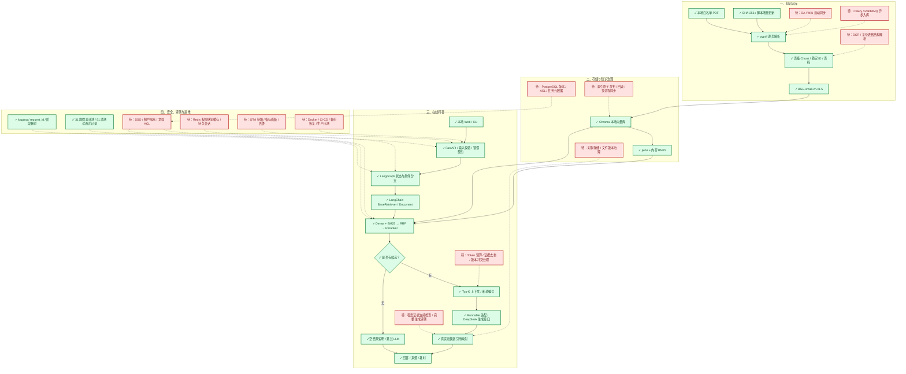

# 企业级 RAG 参考架构与项目完成状态

核对日期：2026-11-12。绿色（✓）是具体能力已实现并有本地验证；红色（待）是未实现或尚未完成验证。红色扩展不是全部都要建设，按业务选择。虚线表示待接入能力，非当前运行路径。

## 技术应用

| 状态 | 能力 / 技术 | 当前用途或建设目标 |
|---|---|---|
| ✓ 绿 | pypdf / 页级切块 | 正文 PDF 逐页提取、稳定知识块与页码；复杂 OCR/表格未覆盖 |
| ✓ 绿 | BGE-small-zh-v1.5 / Chroma | 查询与文档向量检索、本地持久化 |
| ✓ 绿 | jieba / rank-bm25 / 自写 RRF | 精确词召回与语义召回按排名融合；BM25 为内存索引 |
| ✓ 绿 | bge-reranker-base | 对已召回候选精排 |
| ✓ 绿 | LangChain core | BaseRetriever、Document、RunnableLambda 适配既有检索和模型接口 |
| ✓ 绿 | LangGraph | StateGraph 编排、无候选分支和每请求独立状态；无持久化记忆 |
| ✓ 绿 | DeepSeek / 原模型 SDK | 生成接口存在；旧版有有限真实调用记录，新图接入仅模拟生成验证 |
| ✓ 绿 | FastAPI / Pydantic / 原生 HTML-CSS-JS | 本地 Web、CLI/API、参数校验与错误响应 |
| ✓ 绿 | SHA-256 / 增量脚本 | 检测新增、修改、删除；不代表原子发布或在线 BM25 自动同步 |
| ✓ 绿 | Python logging / unittest / 检索评测脚本 | 请求日志、耗时、31 题四路检索对照及上次 51 项通过记录 |
| 待 红 | 企业 SSO / 文档 ACL / 租户隔离 | 身份映射到检索过滤，原文、缓存、历史同样鉴权 |
| 待 红 | Celery + RabbitMQ / 数据源连接器 | 异步入库、重试、失败队列及企业资料同步 |
| 待 红 | PostgreSQL / 对象存储 | 版本、权限、任务状态、原文件与解析产物治理 |
| 待 红 | Token 预算 / 去重 / 冲突处理 | 限制上下文大小并处理资料版本差异 |
| 待 红 | Redis / 会话存储 | 按业务建设权限感知缓存与跨请求会话 |
| 待 红 | OpenTelemetry / 指标看板 | 实际接入 Trace、指标、告警；依赖列表出现不算实现 |
| 待 红 | Docker / CI-CD / 备份 / 压测 | 可重复发布、恢复演练与生产容量验证 |
| 待 红 | 固定生成评测 / 人工复核 / 按需 Ragas | 证据支持、引用准确性、拒答及安全测试 |

## 验证边界与证据

- [框架接入记录](../docs/ai_workflow/execution_logs/RAG-20261112-002.md)：51 项通过为上次执行结果，本次未重跑。
- [真实检索与图集成](RAG-20261112-002_workflow_smoke.json)：索引副本、候选顺序一致、API 200，生成使用模拟函数。
- [历史真实问答](p0_real_qa_verification.md)：2026-11-09 有限外部模型调用，不是新图的真实生成复测。
- [31 题检索评测](eval/cnooc_retrieval_eval_v1.md)：检索指标，不是完整答案正确率。
- LangGraph 路由检查的是候选列表是否为空，不能等同于所有业务无答案问题都能正确拒答。
- 当前是本地原型，绿色不代表生产安全、SLA 或高并发验收。GraphRAG、多 Agent、Kubernetes 按需考虑，不列为必需欠项。

官方参考：[LangGraph Graph API](https://docs.langchain.com/oss/python/langgraph/graph-api)、[文档级权限](https://learn.microsoft.com/en-us/azure/search/search-document-level-access-overview)、[OpenTelemetry](https://opentelemetry.io/docs/)。
