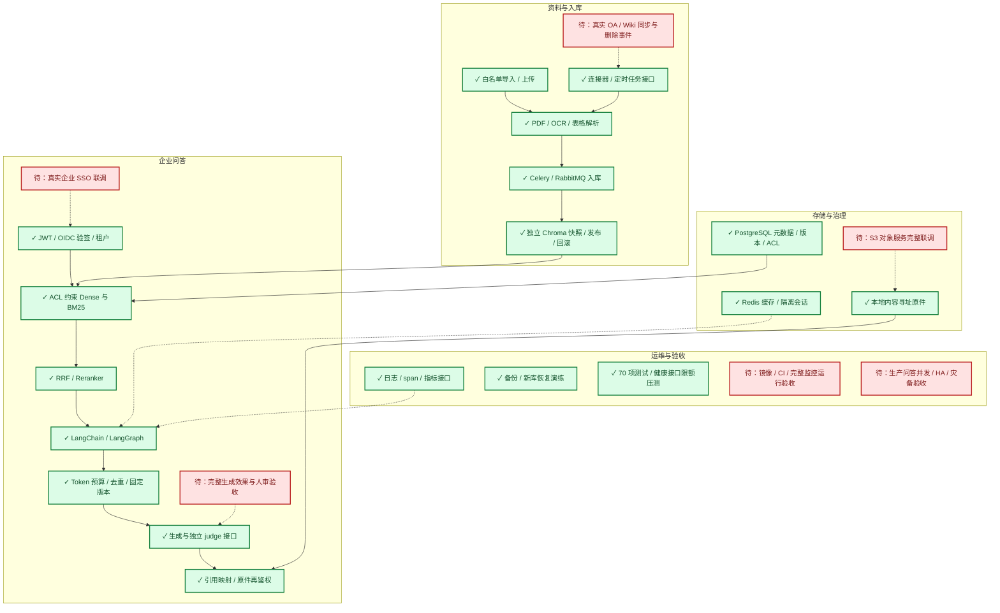

# 企业 RAG 扩展交付与验收状态

日期：2026-11-13（Australia/Sydney）。Task：RAG-20261113-002。

本轮完成独立企业扩展的实现与本地验证，保留旧演示系统。不能把当前状态称为全部生产验收完成。绿色表示具体本地能力已实现并验证；红色表示真实平台、完整部署或效果验收仍待完成。

## 实现

- `app/enterprise/`：独立设置、JWT/OIDC Token 校验、SQLAlchemy 元数据、内容寻址对象存储、不可变租户索引、权限预过滤检索、Celery 任务、连接器、上下文预算、用户会话/缓存、生成及核验、指标/Trace、受保护的 v2 API。
- `scripts/`：私有开发配置、Token 文件、本地服务/worker、基础设施配置注入、白名单资料隔离导入、备份恢复、限额压测与生成评测。
- `requirements-enterprise.txt`、`requirements-ocr.txt`：隔离依赖入口；不改原 requirements 的固定版本。
- `Dockerfile`、`compose.enterprise.yml`、`deploy/`、`.github/workflows/tests.yml`：应用/worker/scheduler、数据库、消息队列、S3、监控和 CI 配置。
- 原 `app.api` 和现有工作流页面不改。正式 CNOOC PDF、来源清单、原 Chroma 和评测集不作为本轮写入目标。新租户资料在 `.enterprise/`，不进入 Git。

## 实际验证

| 验证 | 结果与边界 |
|---|---|
| 完整回归 | 70 项全部通过，23.612 秒；包含原 51 项和新增 19 项 |
| ACL / 租户隔离 | 授权集合先约束两路召回；跨租户列表/原件/证据、权限撤销后缓存及历史隔离测试通过 |
| OIDC | 本地生成 RS256 Token 的签名、issuer、audience、过期检查通过；未接真实企业 IdP |
| 版本和发布 | 失败不切换旧指针、版本回滚、引用原件版本一致、撤回即时生效测试通过 |
| 真 PostgreSQL / RabbitMQ / Redis | 元数据落库、真实 worker 接收队列并完成入库、真实 Redis 二次查询缓存命中；生成使用模拟函数 |
| OCR / 表格 | Docling 2.150.0 处理新建单页图片 PDF，正确提取 Sydney / 200 AUD 表格；未遍历业务扫描件 |
| 恢复演练 | 从 PostgreSQL 逻辑备份恢复到全新 restore_* 数据库，6 个表逐表行数一致；没有覆盖原库 |
| 会话 / 缓存 / Token 预算 | 用户与 ACL/发布版本隔离，正文去重、Token 上限测试通过 |
| 证据核验 | 引用结构校验、judge JSON 失败关闭测试通过；语义判别器效果不能仅由测试代码证明 |
| Trace / 指标 | 内存 exporter 测试确认请求 span，无敏感属性；Token 用量计数测试通过；完整外部 Collector/dashboard 尚待联调 |
| 限额压测 | 20 请求、4 并发健康接口，0 错误；这不是 RAG 并发或生产 SLA 验收 |
| 隔离资料导入 | 7 份白名单 PDF、146 个新 Chunk；不同于旧版页级 194 Chunk，旧检索指标不迁移到新索引 |
| 本地 HTTP | 8030 的 health、ready、鉴权后的 documents 均 200，文档列表为 7 |
| 真实生成与核验 | 入职合规问题 HTTP 200、judge_passed、3 条来源；复查缓存答案包含合规承诺书和保密要求，原件再次鉴权下载与白名单原 PDF 哈希一致（第 6/10/14 页）。仅一题，不报告全量准确率 |
| 依赖和格式 | pip check 无损坏依赖；requirements-enterprise dry-run 可解；git diff --check 通过 |

证据：[队列/缓存集成](RAG-20261113-002_integration.json)、[OCR](RAG-20261113-002_ocr.json)、[恢复](RAG-20261113-002_recovery.json)、[健康接口压测](RAG-20261113-002_health_load.json)、[隔离导入](RAG-20261113-002_corpus_import.json)、[真实问答记录](RAG-20261113-002_live_query.json)。真实问答以最后一个 JSON 的实际 HTTP 状态及 verification 字段为准，不反推成功。

## 未完成的外部验收

1. 没有企业 IdP/OA/Wiki 平台配置，真实 SSO 与远端内容/权限映射、分页和删除事件联调待完成。现有连接器支持指定 JSON/Confluence 页面；不是所有企业 OA 通用适配器。
2. Docker daemon 存在 Created/启动/删除停滞。S3、OTel Collector、Prometheus、Grafana 和完整 API 容器还没有通过运行验收。提供 named-volume 初始化方案，不能只凭 Compose 文件将节点标绿。
3. GitHub Actions 未推送/触发，完整应用 Docker 镜像未完成构建运行。OCR 是可选本地安装；默认基础镜像不含 Docling 依赖。
4. 没有完整业务生成效果、人审和对抗样本验收；单题核验不代表答案准确率。生产问答容量、SLA、跨主机锁/HA、S3 恢复导入及灾备目标仍待验证。

## 更新架构图

运行方式和各接口详见 [企业运行说明](../docs/enterprise_runtime.md)。未 Commit、Tag 或 Push。
